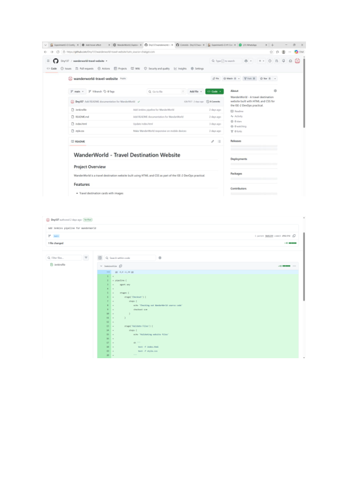
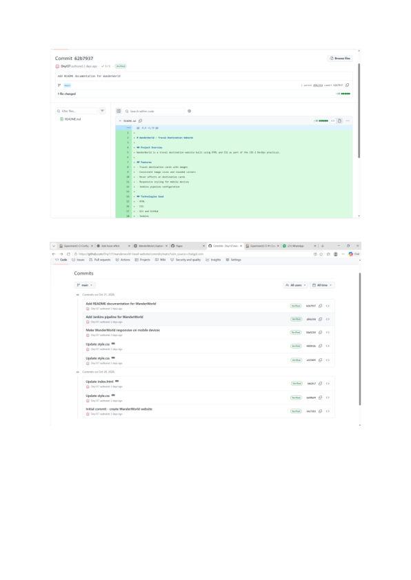
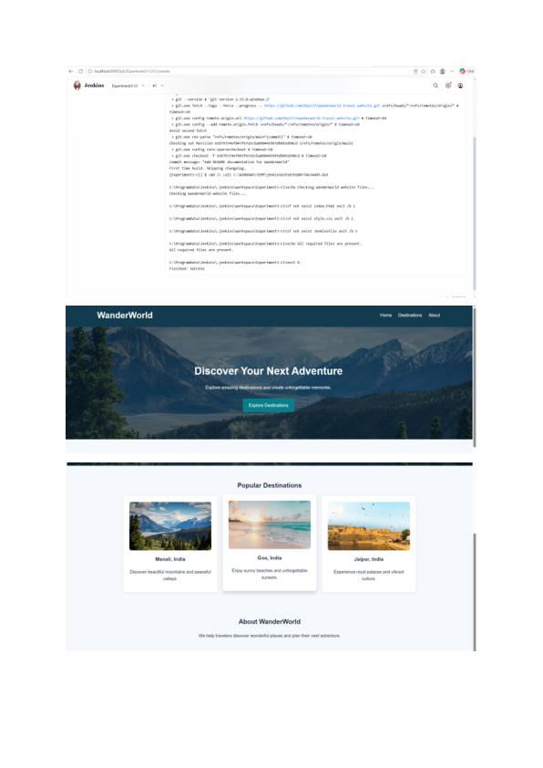

# WanderWorld - Travel Destination Website

## Project Overview
WanderWorld is a travel destination website built using HTML and CSS as part of the ISE-2 DevOps practical.

## Features
- Travel destination cards with images
- Consistent image sizes and rounded corners
- Hover effects on destination cards
- Responsive styling for mobile devices
- Jenkins pipeline configuration

## Technologies Used
- HTML
- CSS
- Git and GitHub
- Jenkins

## Project Files
- `index.html` - Website structure
- `style.css` - Website styling
- `Jenkinsfile` - Jenkins pipeline configuration
- `README.md` - Project documentation

## Jenkins Pipeline
The Jenkinsfile defines stages to check out the source code, validate the required website files, and complete the sample build stage.

## Author
ISE-2 DevOps Practical

## Project Screenshots and Evidence

These screenshots document the WanderWorld project, GitHub repository, and Jenkins integration.

### 1. GitHub Repository and Project Progress

### 2. Jenkins Integration

### 3. Website and Project Evidence

### Live Website

[Visit WanderWorld](https://dny137.github.io/wanderworld-travel-website/)

### Source Code

[View GitHub Repository](https://github.com/Dny137/wanderworld-travel-website)
